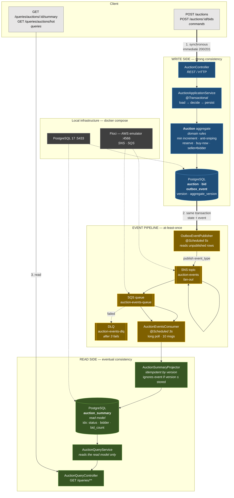
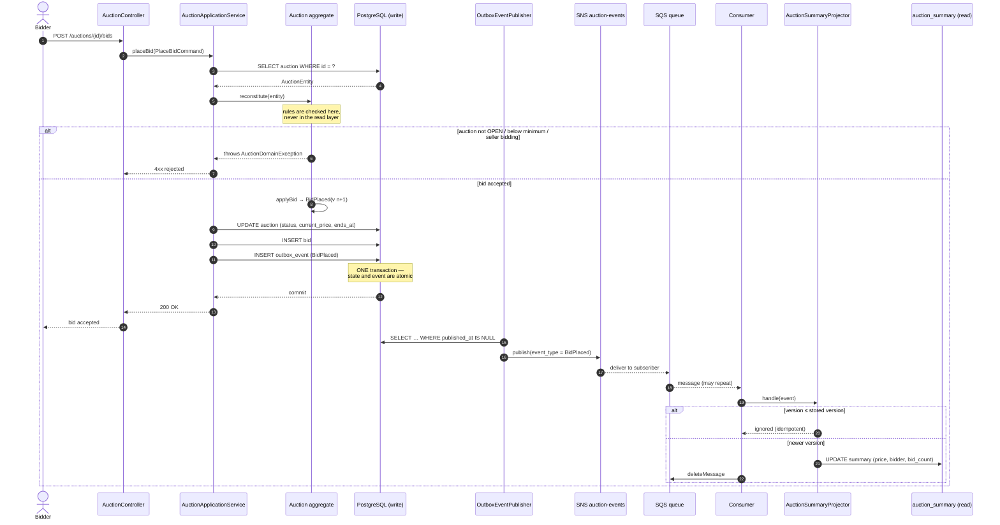
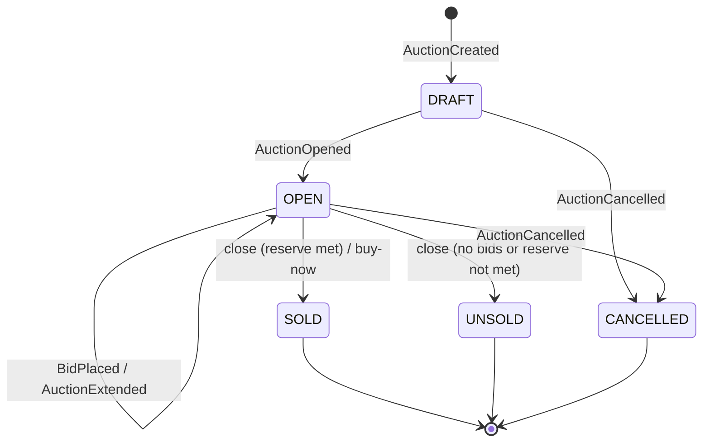
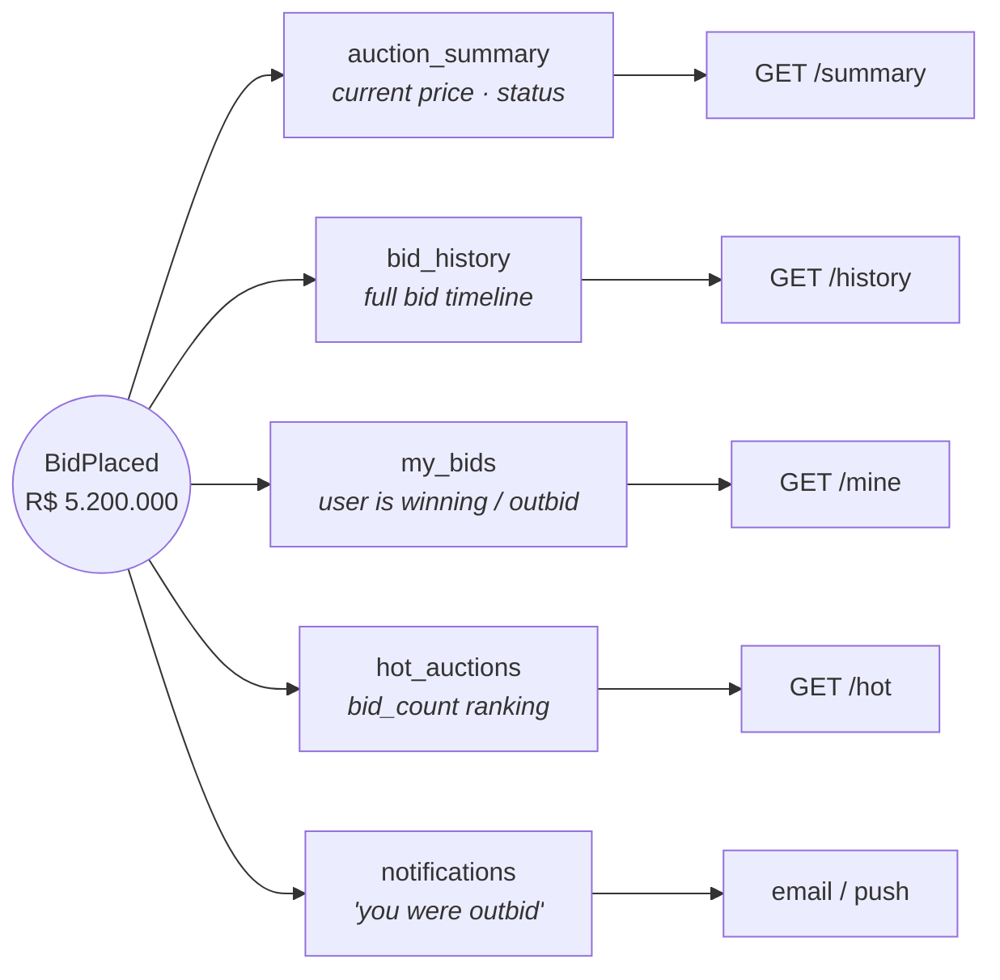
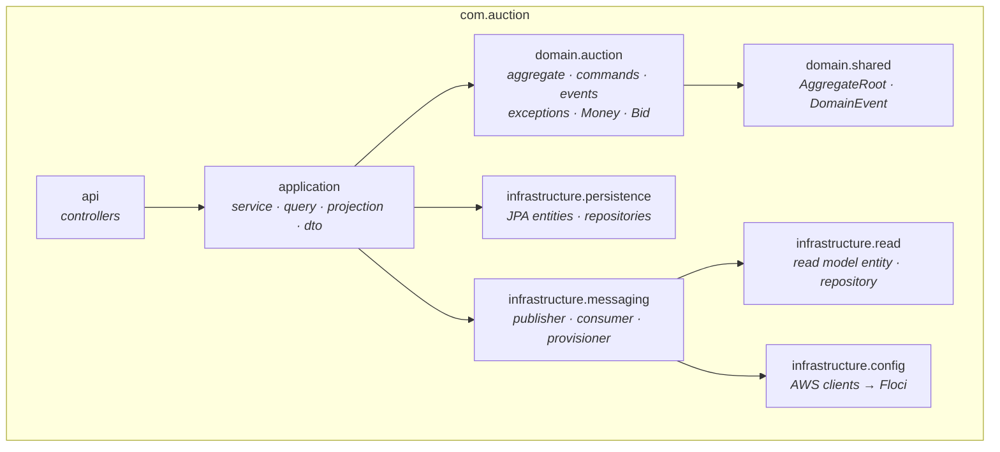

# Auction CQRS — Architecture

High-level view of the auction system: **Command side** (write) and **Query side** (read),
connected by the **Transactional Outbox** and an **asynchronous event pipeline** running on
the local AWS emulator (Floci).

---

## 1. Overview

### The flow in three steps

1. **Write** — the command is validated by the `Auction` aggregate and the new state plus the
   domain event are committed **in the same transaction**. The client gets its response immediately.
2. **Propagate** — a scheduled publisher drains `outbox_event` rows into an SNS topic, which
   fans out to SQS. Delivery is *at-least-once*.
3. **Read** — a consumer applies each event to the `auction_summary` read model, and queries
   serve that model — never the write tables.

> The system is **eventually consistent**: the write side is immediately correct, the read side
> converges a few seconds later. This is the deliberate trade-off that makes reads cheap and
> independently scalable.

---

## 2. Detailed sequence — placing a bid

**Guarantees**

| Concern | How it is handled |
|---|---|
| Lost event | Outbox row is written in the same transaction as the state |
| Duplicate event | Projector ignores any version ≤ `last_event_version` |
| Out-of-order event | Same version check discards stale updates |
| Poison message | SQS retries 3×, then the message lands in the DLQ |
| Concurrent bids | JPA `@Version` raises `OptimisticLockingFailureException` |
| Event ordering per auction | Sequential `aggregate_version`; SQS FIFO is the upgrade path |

---

## 3. Aggregate state machine

---

## 4. Read models served from one event stream

Only `auction_summary` is implemented today. Each additional model would get its **own SQS
queue**, so a failing projection never blocks the others — and this fan-out is what the SNS
topic exists for.

---

## 5. Packages

The dependency rule holds: **domain knows nothing** about JPA, HTTP or AWS.

---

## 6. Local infrastructure

| Container | Port | Purpose |
|---|---|---|
| `auction-postgres` | 5433 | write side + read model |
| `auction-floci` | 4566 | SNS + SQS emulator (`/_floci/ui`) |

> Port 5433 instead of 5432 because a native PostgreSQL already occupies 5432 on this machine.