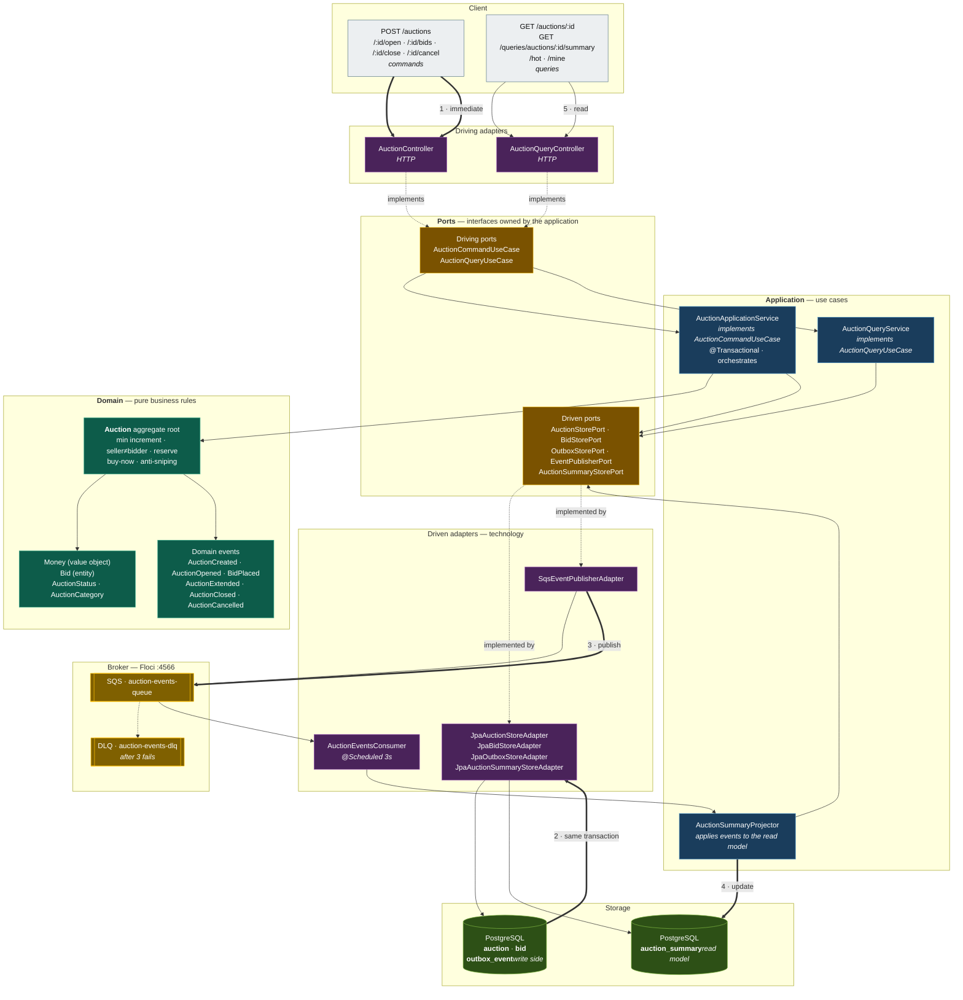
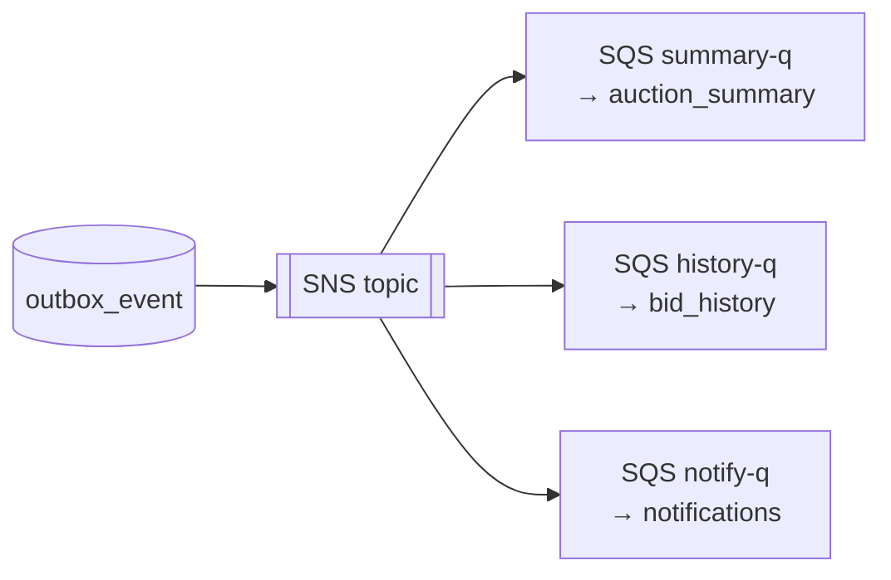
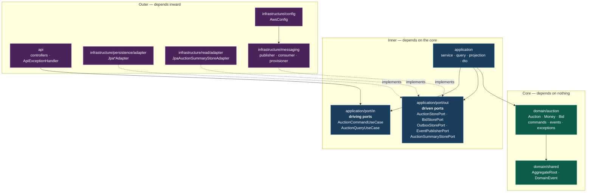
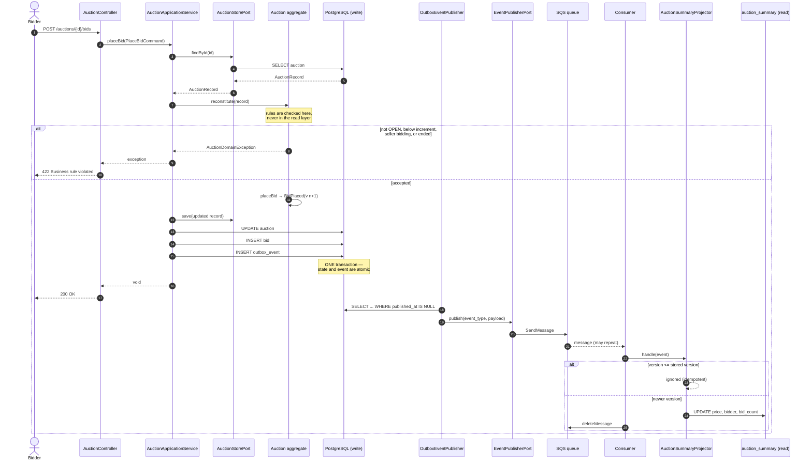
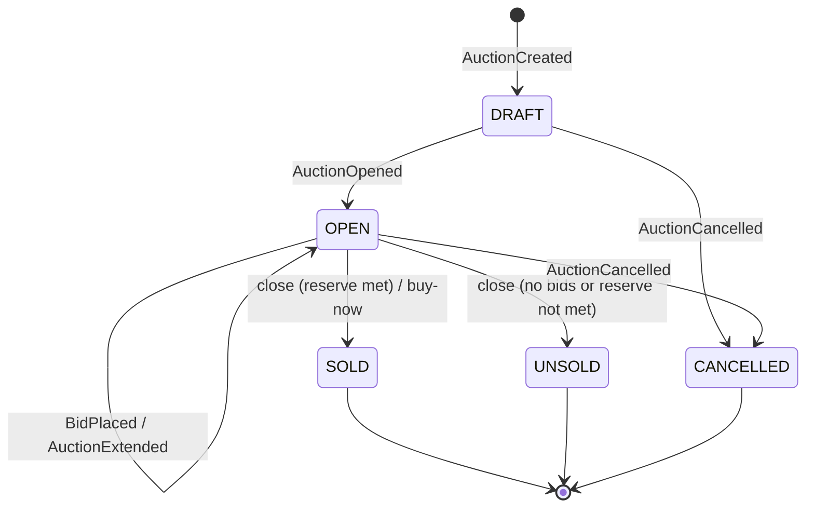
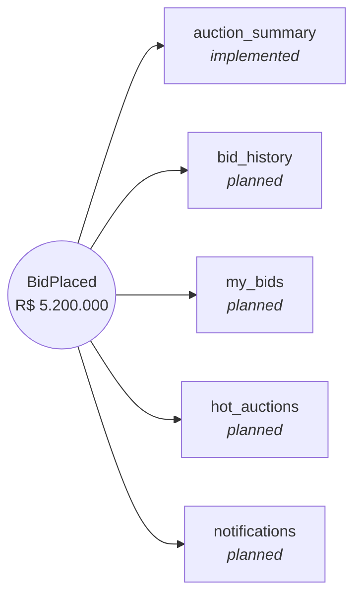

# Auction CQRS — Architecture

An auction system built with **Domain-Driven Design**, **hexagonal architecture** (ports &
adapters) and **CQRS**, with the write and read sides connected by the **Transactional Outbox**
and an asynchronous event pipeline running on the local AWS emulator (Floci).

---

## 1. Overview



### The flow in five steps

1. **Command** — the HTTP adapter calls a driving port; the application service loads the
   aggregate through a driven port.
2. **Decide** — the `Auction` aggregate validates the invariants and emits domain events.
3. **Persist atomically** — the write state and the outbox row are committed **in the same
   transaction**. The client gets its response immediately.
4. **Propagate** — a scheduled publisher drains `outbox_event` into SQS (at-least-once).
5. **Project** — a consumer applies each event to `auction_summary`; queries serve that model
   only, never the write tables.

> The system is **eventually consistent**: the write side is immediately correct, the read side
> converges a few seconds later.

### Why no SNS (yet)

An SNS topic only earns its place when **more than one consumer** needs the same event stream —
that is what fan-out means. With a single read model, publishing straight to SQS removes a moving
part without losing anything. When the second read model (`bid_history`) appears, the publisher is
the only class that changes:



Each queue then gets its own retry and DLQ, so one failing projection cannot stall the others.

---

## 2. Hexagonal layers



**The dependency rule:** arrows point inward only. `domain` and `application` never import from
`infrastructure` — this is enforced by the compiler, not by convention.

**Why it matters here:** the ports are why `AuctionApplicationServiceTest` can run without a
database, and why the read model could later move to DynamoDB by swapping a single adapter.

---

## 3. Detailed sequence — placing a bid



### Guarantees

| Concern | How it is handled |
|---|---|
| Lost event | Outbox row is written in the same transaction as the state |
| Duplicate event | Projector ignores any version ≤ `last_event_version` |
| Out-of-order event | Same version check discards stale updates |
| Poison message | SQS retries 3×, then the message lands in the DLQ |
| Concurrent bids | JPA `@Version` raises `OptimisticLockingFailureException` → HTTP 409 |
| Event ordering per auction | Sequential `aggregate_version`; SQS FIFO is the upgrade path |

### HTTP contract

| Situation | Status | Payload |
|---|---|---|
| Business rule violated | **422** | `{"title":"Business rule violated","detail":"..."}` |
| Unknown auction id | **404** | `{"title":"Resource not found"}` |
| Concurrent modification | **409** | `{"title":"Concurrent modification"}` |
| Malformed payload | **400** | `{"title":"Invalid request"}` |

---

## 4. Aggregate state machine



---

## 5. Read models served from one event stream



Only `auction_summary` exists today. It serves **three screens** from a single denormalized row,
which is the practical payoff of the read model: the ranking query is an index scan instead of a
`COUNT(*) + GROUP BY` over the bid table.

---

## 6. Data model

One database, four tables — the separation is logical, not physical.

| Table | Side | Purpose |
|---|---|---|
| `auction` | write | Aggregate state. `version` = JPA lock, `aggregate_version` = event order |
| `bid` | write | Full bid history |
| `outbox_event` | write | Events not yet published (JSONB payload) |
| `auction_summary` | read | Denormalized projection + indexes on status, bidder, bid_count |

---

## 7. Running it

```bash
docker compose up -d          # Postgres :5433 + Floci :4566
powershell -ExecutionPolicy Bypass -File scripts/run.ps1
```

The queue and DLQ are created automatically by `AwsProvisioner` on startup (idempotent).
Floci UI: `http://localhost:4566/_floci/ui`.

> Port **5433** because a native PostgreSQL already occupies 5432 on this machine.

### Testing

```bash
./mvnw test
powershell -ExecutionPolicy Bypass -File scripts/api-test.ps1
```

| Suite | Count | Scope |
|---|---|---|
| `AuctionTest` | 21 | Invariants, transitions, anti-sniping, reconstitution |
| `AuctionApplicationServiceTest` | 6 | Orchestration with mocked ports (no DB, no broker) |

> **Build note:** Maven builds into `build/` rather than `target/`. The VS Code Java extension
> compiles into `target/classes` with Eclipse JDT and can leave broken class files behind, which
> Maven would then treat as up to date. Keeping the directories apart makes the tools independent.